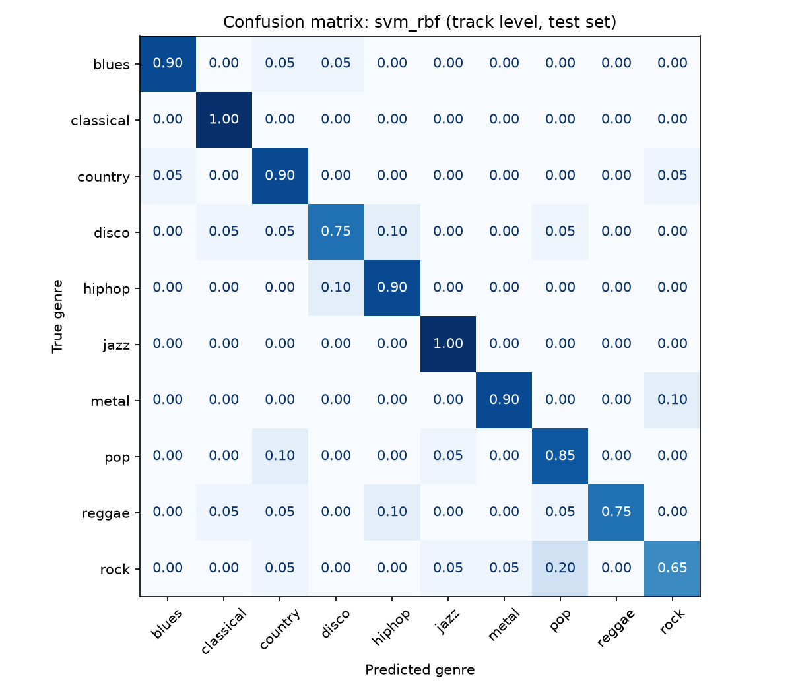
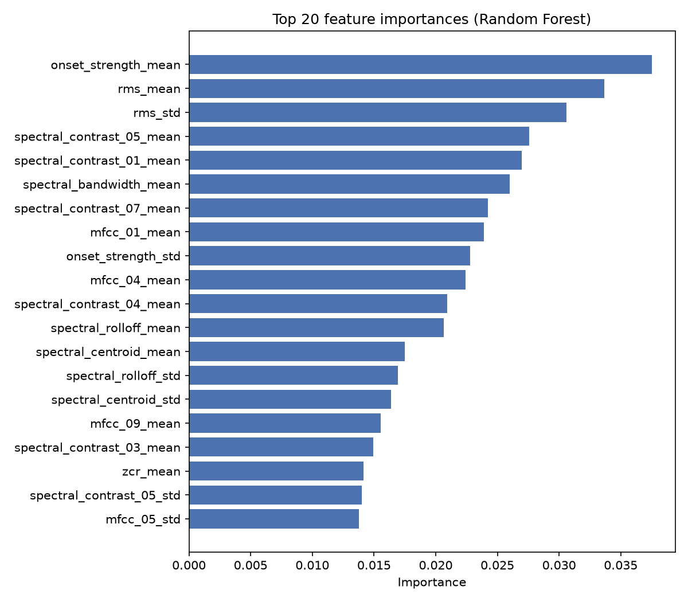

# genre-lens

Music genre classification from audio features (MFCC, chroma, spectral, rhythm) with a reproducible ML pipeline.

[](https://github.com/NinTobias/genre-lens/actions/workflows/ci.yml)


> **Status:** work in progress. First results are below; open items are listed in the [roadmap](#roadmap).

## Motivation

I built [nebulaviz](https://github.com/NinTobias/nebulaviz), a real-time audio visualizer, and worked with spectral analysis and beat detection there. This project asks the next question: how well can those same signals be used to *predict* what kind of music a track is?

## Results

Evaluation on 200 held-out test tracks (20 per genre) and 5-fold track-grouped cross-validation on the 799 training tracks. All scores are at the **track level**: the predictions for the ~10 windows of a track are combined by majority vote. Hyperparameters are fixed (no tuning yet).

| Model | CV accuracy (mean ± std) | Test accuracy | Test macro-F1 | Test accuracy per window |
|---|---|---|---|---|
| Dummy baseline | 0.100 ± 0.000 | 0.100 | 0.018 | 0.100 |
| Logistic Regression | 0.791 ± 0.032 | 0.805 | 0.798 | 0.721 |
| Random Forest | 0.765 ± 0.011 | 0.760 | 0.756 | 0.729 |
| **SVM (RBF)** | **0.832 ± 0.020** | **0.860** | **0.859** | **0.772** |

The SVM was chosen by its cross-validation score, not its test score. With only 200 test tracks, the test accuracy carries an uncertainty of roughly ±5 percentage points (95 % interval about 81–91 %), so the cross-validation estimate is the more reliable number. Combining windows into track predictions improves every model (SVM: 77.2 % per window, 86.0 % per track).



### Error analysis (SVM, test set)

- **Easiest genres:** classical and jazz are recognised perfectly (recall 1.00); metal, blues, country and hip-hop reach 0.90.
- **Hardest genre:** rock (recall 0.65, F1 0.72). Four of 20 rock tracks are predicted as pop, the most frequent single error.
- **Pop and country act as catch-all classes:** both have the lowest precision (0.74 and 0.75) because they absorb misclassified tracks from several other genres (6 false positives each).
- **Disco and hip-hop are mixed up in both directions** (2 tracks each way), and 2 reggae tracks are predicted as hip-hop. A plausible reason, which has not been tested here, is a similar rhythmic and spectral profile (steady beat, prominent bass and drums).
- **Caution:** every genre has only 20 test tracks, so one track equals 5 percentage points. Differences of a few tracks should not be over-interpreted.

### Feature importance



In the Random Forest, the most important features describe energy and dynamics (onset strength, RMS and its variation) and spectral shape (spectral contrast bands, bandwidth, rolloff), followed by individual MFCCs. No chroma or tempo feature appears in the top 20. Two caveats: these importances come from the weakest model, and impurity-based importances are biased towards correlated and continuous features. In addition, loudness features may partly reflect recording and mastering differences instead of musical content. An ablation without the loudness features would test this.

## Approach

1. **Data:** GTZAN (10 genres, 100 clips of 30 s each). See [Limitations](#limitations).
2. **Features** (per clip or 3 s window, aggregated as mean and standard deviation):
   - MFCCs (20 coefficients)
   - Spectral centroid, bandwidth, rolloff, contrast
   - Chroma
   - Zero-crossing rate, RMS energy
   - Tempo and onset strength (rhythm)
3. **Models:** Logistic Regression, Random Forest, SVM, compared against a dummy baseline.
4. **Evaluation:** models predict per 3 s window; predictions are combined per track by majority vote, and **track-level** scores are the headline numbers. Track-grouped, stratified cross-validation on the train tracks is used to compare models, the best model is chosen by CV score, and the held-out test tracks are used once for the final scores. Reported: accuracy, macro-F1, confusion matrix, feature importance.
5. **Leakage control:** all windows of one track always stay in the same split.

## Quickstart

```bash
git clone https://github.com/NinTobias/genre-lens.git
cd genre-lens
python -m venv .venv
source .venv/bin/activate        # Windows: .venv\Scripts\activate
pip install -e ".[dev]"
pytest
```

Place the dataset as described in [`data/README.md`](data/README.md), then extract and cache the features:

```bash
python -m genre_lens.features --n-jobs -1          # writes data/features.parquet
python -m genre_lens.features --force              # recompute after changing the config
```

Train and compare the models (cross-validation on the train tracks, one final evaluation on held-out test tracks):

```bash
python -m genre_lens.train
```

This writes `reports/results.md` and `reports/results.csv` (scores), `reports/metrics.json`, `reports/classification_report.txt`, `reports/figures/confusion_matrix.png`, `reports/figures/feature_importance.png` and the best model to `models/best_model.joblib` (not tracked by git). A prediction command will be documented here once implemented.

## Project structure

```
genre-lens/
├── configs/          # Experiment configuration (YAML)
├── data/             # Datasets (not tracked, see data/README.md)
├── notebooks/        # Exploration and error analysis
├── src/genre_lens/   # Package: data, features, dsp, train, evaluate, predict
├── tests/            # Unit and pipeline tests (pytest)
├── models/           # Trained models (not tracked by default)
└── reports/figures/  # Plots used in this README
```

## Roadmap

- [x] Repository setup
- [x] Data loading and track-aware train/test split (with leakage tests)
- [x] Feature extraction with caching (91 features per 3 s window)
- [ ] EDA notebook
- [x] Baseline and classical models with cross-validation
- [x] Confusion matrix, feature importance, first error analysis
- [x] Unit tests and CI (GitHub Actions)
- [ ] NumPy STFT implementation, validated against `librosa.stft`
- [ ] Prediction CLI
- [ ] Ablation: effect of loudness features (RMS, onset strength)
- [ ] Hyperparameter tuning (nested with the cross-validation)
- [ ] Optional: CNN on mel-spectrograms for comparison

## Limitations

- **Dataset faults:** GTZAN is a common benchmark but has known problems: duplicated clips, mislabeled tracks and distortions (Sturm, 2013). One file (`jazz.00054.wav`) is corrupt and is skipped, so 999 tracks are used.
- **No artist-level split:** GTZAN has no artist labels, so the split is per track, not per artist. The dataset is known to contain several tracks by the same artists, which probably makes the reported accuracy optimistic compared with unseen music.
- **Single split:** the test set is one split of 200 tracks. Use the cross-validation numbers for model comparison.
- **No tuning:** hyperparameters are fixed. Tuning could change the ranking of the models.
- **Short windows:** tempo estimated from 3 s windows is noisy.

The results are meant for comparing methods, not as a measure of real-world performance.

## License

MIT, see [LICENSE](LICENSE).
